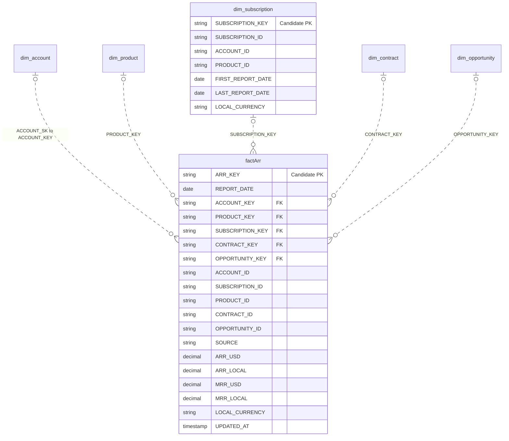
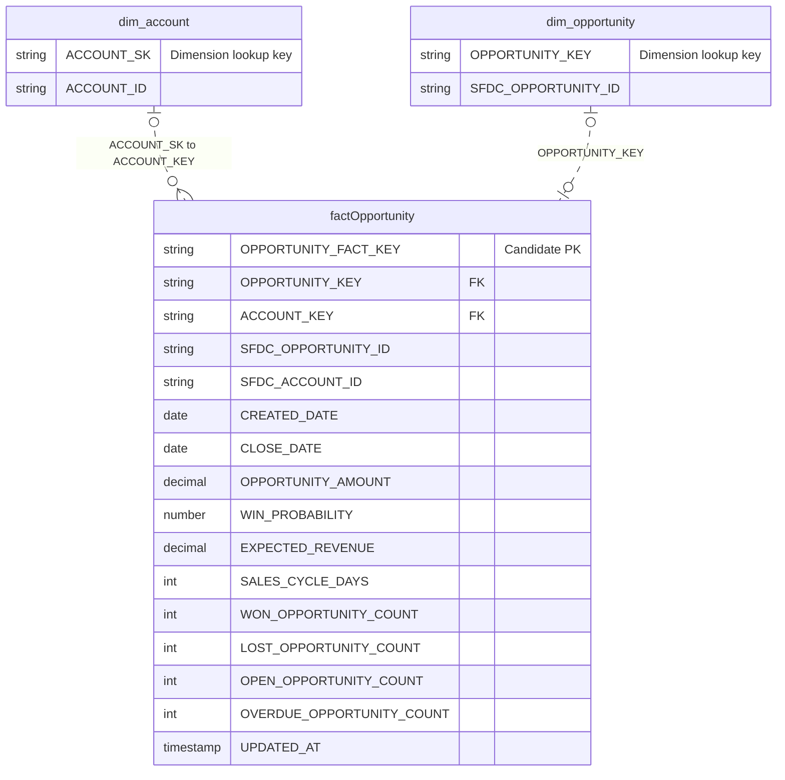

# Analytics MART ERD

`ANALYTICS_PROD_MART/MART`

The diagrams show logical foreign keys and intended cardinalities for matched business records. Candidate keys and cardinalities require validation against warehouse data. Data types are logical where inherited from upstream models.

## Subscription revenue

## Salesforce opportunities

## Join columns

Both fact models left-join their upstream data to dimensions on business IDs and fall back to the surrogate hash of `-1` when the dimension key is null.

| Fact | Dimension | Upstream business ID | Dimension business ID | Dimension key → fact key |
| --- | --- | --- | --- | --- |
| `factArr` | `dim_account` | `ACCOUNT_ID` | `ACCOUNT_ID` | `ACCOUNT_SK` → `ACCOUNT_KEY` |
| `factArr` | `dim_product` | `PRODUCT_ID` | `PRODUCT_ID` | `PRODUCT_KEY` → `PRODUCT_KEY` |
| `factArr` | `dim_subscription` | `SUBSCRIPTION_ID` | `SUBSCRIPTION_ID` | `SUBSCRIPTION_KEY` → `SUBSCRIPTION_KEY` |
| `factArr` | `dim_contract` | `CONTRACT_ID` | `CONTRACT_ID` | `CONTRACT_KEY` → `CONTRACT_KEY` |
| `factArr` | `dim_opportunity` | `OPPORTUNITY_ID` | `OPPORTUNITY_ID` | `OPPORTUNITY_KEY` → `OPPORTUNITY_KEY` |
| `factOpportunity` | `DIM_ACCOUNT` | `SFDC_ACCOUNT_ID` | `ACCOUNT_ID` | `ACCOUNT_SK` → `ACCOUNT_KEY` |
| `factOpportunity` | `dimOpportunity` | `SFDC_OPPORTUNITY_ID` | `SFDC_OPPORTUNITY_ID` | `OPPORTUNITY_KEY` → `OPPORTUNITY_KEY` |

The opportunity diagram uses the filenames from the MART listing. The last two rows preserve the dbt reference names used in `factOpportunity.sql`.

## Model grain

| Model | Grain indicated by the SQL |
| --- | --- |
| `factArr` | Intended one row per `REPORT_DATE` and `SUBSCRIPTION_ID`, the inputs to `ARR_KEY`. |
| `factOpportunity` | Intended one row per `SFDC_OPPORTUNITY_ID`, the input to `OPPORTUNITY_FACT_KEY`. |
| `dim_subscription` | One row per `SUBSCRIPTION_ID`, `ACCOUNT_ID`, and `PRODUCT_ID`, as defined by the grouping. |

`dim_subscription` generates `SUBSCRIPTION_KEY` from `SUBSCRIPTION_ID` alone. If a subscription spans multiple account or product combinations, the join on `SUBSCRIPTION_ID` can duplicate rows in `factArr` and inflate ARR and MRR totals.
