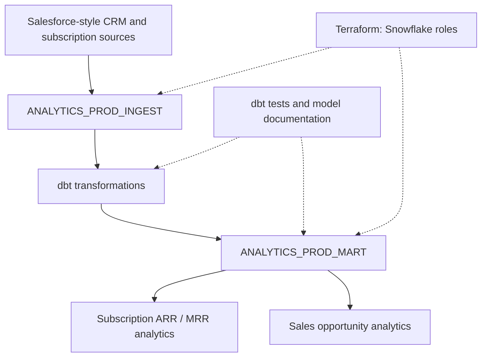

# Enterprise Data Platform

**Snowflake · dbt · SQL · Terraform · Dimensional Modeling · Data Quality**

A portfolio project demonstrating the organization of a modern analytics platform: source ingestion definitions, transformations, dimensional marts, and documented engineering standards. The repository includes Salesforce-style CRM and subscription-revenue modeling examples.

> **Project scope:** This repository demonstrates data engineering design and implementation examples. Documentation distinguishes implemented models from recommended practices; it does not imply a live production deployment or automated CI/CD unless explicitly shown in code.

## Architecture at a glance



*Logical overview of the repository, not a verified runtime orchestration diagram.*

## What this project demonstrates

| Area | Repository examples | Engineering focus |
| --- | --- | --- |
| Ingestion | `ANALYTICS_PROD_INGEST/` | Source definitions and separation of raw data from analytics models |
| Transformations | `ANALYTICS_PROD_MART/TRANSFORM/` | Reusable business transformations and upstream model preparation |
| Dimensional marts | `ANALYTICS_PROD_MART/MART/` | Fact and dimension models, grains, and relationship design |
| Revenue analytics | `factArr.sql` | ARR/MRR measures and subscription-level reporting |
| Sales analytics | `factOpportunity.sql` | Opportunity measures and account relationships |
| Data quality | dbt YAML files | Documented tests and opportunities for stronger validation |
| Access management | `snowflake_roles.tf` | Terraform-based Snowflake role definitions |
| Reusable SQL | `macros/` | Shared dbt logic |

## Dimensional modeling

The analytics mart includes two primary subject areas:

**Subscription revenue:** `factArr` models recurring-revenue measures including `ARR_USD`, `ARR_LOCAL`, `MRR_USD`, and `MRR_LOCAL`, with account, product, subscription, contract, and opportunity lookup keys.

**Sales opportunities:** `factOpportunity` models opportunity amounts, win probability, expected revenue, sales-cycle duration, and opportunity-status counts.

See the [Analytics MART ERD](MART_ERD.md) for the documented logical relationships, column definitions, and intended grain. **Key uniqueness and join cardinalities still require validation against warehouse data.** In particular, the documented `dim_subscription` grain should be checked against its `SUBSCRIPTION_ID` join to avoid possible revenue duplication.

## Repository layout

```text
ENTERPRISE_DATA_PLATFORM/
├── ANALYTICS_PROD_INGEST/      # Source ingestion definitions
├── ANALYTICS_PROD_MART/
│   ├── TRANSFORM/              # Transformation models
│   └── MART/                   # Facts, dimensions, and model YAML
├── macros/                     # Reusable dbt SQL macros
├── docs/                       # Engineering and architecture documentation
├── MART_ERD.md                 # Logical mart entity relationships
├── snowflake_roles.tf          # Snowflake access-role definitions
└── README.md                   # Project overview
```

## Engineering principles

This project is organized around several principles: clearly defined model grain, consistent naming, separation of ingestion and business transformations, reusable SQL, traceable business definitions, and validation of keys and financial measures.

The documents below describe both the project's design and **recommended standards for further development**. They should not be read as proof that every control is already enforced automatically.

| Document | Purpose |
| --- | --- |
| [Architecture](docs/ARCHITECTURE.md) | Logical layers, data flow, and responsibilities |
| [Data engineering standards](docs/DATA_ENGINEERING_STANDARDS.md) | SQL/dbt development conventions and maintainability |
| [Naming conventions](docs/NAMING_CONVENTIONS.md) | Consistent model, column, and file naming |
| [Data quality standards](docs/DATA_QUALITY_STANDARDS.md) | Validation and testing expectations |
| [Modeling decisions](docs/MODELING_DECISIONS.md) | Fact grain, dimension relationships, and trade-offs |
| [MART ERD](MART_ERD.md) | Subscription revenue and opportunity relationships |

## Suggested validation before production use

1. Confirm `factArr` and `factOpportunity` candidate keys are unique at their intended grains.
2. Verify that dimension business IDs are unique for each fact lookup, particularly `dim_subscription`.
3. Reconcile ARR/MRR totals before and after dimension joins.
4. Run the dbt tests configured in the repository and document the results.
5. Review access privileges and credentials before deployment.

## Notes for reviewers

Start with the [MART ERD](MART_ERD.md), then inspect `ANALYTICS_PROD_MART/MART/` for SQL implementations and the corresponding YAML tests. The [`docs/`](docs/) directory explains the design standards and future improvements.
