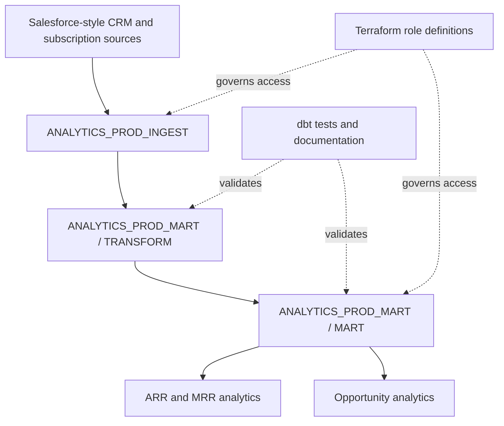

# Enterprise Data Platform — Architecture

## Purpose
This repository demonstrates a Snowflake and dbt analytics platform for Salesforce-style CRM and subscription-revenue modeling. The design separates source ingestion, business transformations, and analytics-ready marts.

> **Scope:** This document describes the repository's logical design. It does not assert that all components are deployed, scheduled, or running in production. Verify deployment details against the environment.

## Logical data flow

The diagram illustrates intended responsibilities, not verified operational integrations.

## Repository components

| Component | Responsibility |
| --- | --- |
| `ANALYTICS_PROD_INGEST/` | Source-facing definitions and ingestion-related SQL/configuration |
| `ANALYTICS_PROD_MART/TRANSFORM/` | Standardization and reusable business transformations |
| `ANALYTICS_PROD_MART/MART/` | Dimensional models and business-facing facts |
| `macros/` | Shared dbt SQL utilities |
| `snowflake_roles.tf` | Snowflake role infrastructure definition |
| `MART_ERD.md` | Logical fact/dimension relationships and grain notes |

## Key analytical subjects

### Subscription revenue
`factArr` records subscription revenue measures such as `ARR_USD`, `MRR_USD`, local currency values, and `REPORT_DATE`. The documented intended grain is reporting date plus subscription ID. Refer to `MART_ERD.md` for candidate keys and joins.

### Salesforce opportunities
`factOpportunity` includes opportunity amounts, probability, expected revenue, sales-cycle metrics, and status-related counts. The documented intended grain is opportunity ID.

## Design principles
1. Keep source-specific normalization separate from business metric definitions.
2. Declare the grain of every fact and dimension before writing joins.
3. Validate dimension lookup uniqueness before enriching facts.
4. Test revenue reconciliation before and after enrichment.
5. Keep warehouse privileges aligned with least-privilege access.

## Operational capabilities to verify
- dbt job scheduling and deployment targets
- CI checks and branch protections
- Source freshness monitoring
- Incremental model configuration
- Warehouse performance and cost monitoring

Do not describe these as implemented until evidence is available in code or execution logs.
